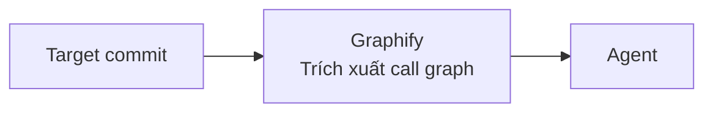

# Báo cáo thực nghiệm benchmark VulnGym

---

## 1. Tóm tắt kết quả

Hoàn thành đánh giá **166 commits** trên **23 repositories**:
 * **276 / 382 critical operation file recall** (**72.25%**)
 * **233 / 382 entry point file recall** (**60.99%**).

Model đánh giá: Gemini 3 flash

So sánh với VulnGym:

### Mức easy trace <= 7

* **Xét theo critical operation file recall (71.38%)**
* **Xét theo entry point file recall (66.54%)**
* **Xét theo critical operation line recall (19.70%)**
* **Xét theo entry point line recall (19.70%)**
* **Xét theo exact recall (7.84%):**
  * Hơn **3.52%** so với Claude Code + Qwen3.5-9B (4.32%)

### Mức medium trace = 8

* **Xét theo critical operation file recall (85.71%)**
* **Xét theo entry point file recall (42.86%)**
* **Xét theo critical operation line recall (14.29%)**
* **Xét theo entry point line recall (0.00%)**
* **Xét theo exact recall (0.00%):**
  * Ngang Claude Code + Qwen3.5-2B / 4B (0.00%)
  * Kém **1.79%** so với Claude Code + Qwen3.5-9B (1.79%)

### Mức hard trace >= 9

* **Xét theo critical operation file recall (63.16%):**
  * Hơn **12.00%** so với MiniSWE + DeepSeek-V4-Flash (51.16%)
  * Hơn **14.32%** so với Claude Code + GLM-5.2 (48.84%)
  * Hơn **16.65%** so với OpenHands + MiniMax-M3 (46.51%)

* **Xét theo entry point file recall (57.89%):**
  * Hơn **27.66%** so với MiniSWE + GLM-5.2 (30.23%)
  * Hơn **32.31%** so với Claude Code + GLM-5.2 (25.58%)
  * Hơn **34.63%** so với OpenHands + MiniMax-M3 (23.26%)

* **Xét theo critical operation line recall (21.05%):**
  * Hơn **4.77%** so với MiniSWE + DeepSeek-V4-Flash (16.28%)
  * Kém **2.21%** so với OpenHands + MiniMax-M3 (23.26%)
  * Kém **9.18%** so với Claude Code + GLM-5.2 (30.23%)

* **Xét theo entry point line recall (15.79%):**
  * Hơn **11.14%** so với Claude Code + DeepSeek-V4-Flash (4.65%)
  * Kém **0.49%** so với OpenHands + MiniMax-M3 (16.28%)
  * Kém **2.81%** so với MiniSWE + GLM-5.2 (18.60%)

* **Xét theo exact recall (0.00%):**
  * Ngang Claude Code + Qwen3.5-9B (0.00%)
  * Kém **6.52%** so với Claude Code + DeepSeek-V4-Flash (6.52%)
  * Kém **10.87%** so với MiniSWE + GLM-5.2 (10.87%)
  * Kém **15.22%** so với OpenHands + DeepSeek-V4-Flash (15.22%)

Thời gian hoàn thành: 8 giờ 50 phút

---

## 2. Kết quả chi tiết

### 2.1. Biểu đồ trực quan

<svg viewBox="0 0 760 320" width="100%" xmlns="http://www.w3.org/2000/svg" style="background:#0f172a; border-radius:8px; font-family:-apple-system,BlinkMacSystemFont,'Segoe UI',Roboto,sans-serif; margin: 10px 0;">
  <!-- Title & Legend -->
  <text x="380" y="28" text-anchor="middle" fill="#f8fafc" font-size="15" font-weight="bold">Mức Easy (trace ≤ 7): NCKH vs VulnGym</text>
  <rect x="195" y="42" width="14" height="14" fill="#3b82f6" rx="3"/>
  <text x="215" y="54" fill="#93c5fd" font-size="12" font-weight="bold">NCKH</text>
  <rect x="300" y="42" width="14" height="14" fill="#f97316" rx="3"/>
  <text x="320" y="54" fill="#fdba74" font-size="12" font-weight="bold">VulnGym</text>

  <!-- Grid lines -->
  <line x1="80" y1="75" x2="720" y2="75" stroke="#334155" stroke-dasharray="4"/>
  <text x="70" y="79" text-anchor="end" fill="#94a3b8" font-size="11">100%</text>
  <line x1="80" y1="120" x2="720" y2="120" stroke="#334155" stroke-dasharray="4"/>
  <text x="70" y="124" text-anchor="end" fill="#94a3b8" font-size="11">75%</text>
  <line x1="80" y1="165" x2="720" y2="165" stroke="#334155" stroke-dasharray="4"/>
  <text x="70" y="169" text-anchor="end" fill="#94a3b8" font-size="11">50%</text>
  <line x1="80" y1="210" x2="720" y2="210" stroke="#334155" stroke-dasharray="4"/>
  <text x="70" y="214" text-anchor="end" fill="#94a3b8" font-size="11">25%</text>
  <line x1="80" y1="255" x2="720" y2="255" stroke="#64748b" stroke-width="1.5"/>
  <text x="70" y="259" text-anchor="end" fill="#94a3b8" font-size="11">0%</text>

  <!-- CO File: 71.38% (no comparison) -->
  <rect x="126" y="127" width="36" height="128" fill="#3b82f6" rx="4"/>
  <text x="144" y="119" text-anchor="middle" fill="#93c5fd" font-size="11" font-weight="bold">71.4%</text>
  <text x="144" y="275" text-anchor="middle" fill="#e2e8f0" font-size="12" font-weight="bold">CO File</text>

  <!-- EP File: 66.54% (no comparison) -->
  <rect x="254" y="135" width="36" height="120" fill="#3b82f6" rx="4"/>
  <text x="272" y="127" text-anchor="middle" fill="#93c5fd" font-size="11" font-weight="bold">66.5%</text>
  <text x="272" y="275" text-anchor="middle" fill="#e2e8f0" font-size="12" font-weight="bold">EP File</text>

  <!-- CO Line: 19.70% (no comparison) -->
  <rect x="382" y="220" width="36" height="35" fill="#3b82f6" rx="4"/>
  <text x="400" y="212" text-anchor="middle" fill="#93c5fd" font-size="11" font-weight="bold">19.7%</text>
  <text x="400" y="275" text-anchor="middle" fill="#e2e8f0" font-size="12" font-weight="bold">CO Line</text>

  <!-- EP Line: 19.70% (no comparison) -->
  <rect x="510" y="220" width="36" height="35" fill="#3b82f6" rx="4"/>
  <text x="528" y="212" text-anchor="middle" fill="#93c5fd" font-size="11" font-weight="bold">19.7%</text>
  <text x="528" y="275" text-anchor="middle" fill="#e2e8f0" font-size="12" font-weight="bold">EP Line</text>

  <!-- Exact Recall: 7.84% vs 4.32% -->
  <rect x="617" y="241" width="36" height="14" fill="#3b82f6" rx="4"/>
  <text x="635" y="233" text-anchor="middle" fill="#93c5fd" font-size="11" font-weight="bold">7.8%</text>
  <rect x="659" y="247" width="36" height="8" fill="#f97316" rx="4"/>
  <text x="677" y="239" text-anchor="middle" fill="#fdba74" font-size="11" font-weight="bold">4.3%</text>
  <text x="656" y="275" text-anchor="middle" fill="#e2e8f0" font-size="12" font-weight="bold">Exact Recall</text>

  <text x="380" y="303" text-anchor="middle" fill="#94a3b8" font-size="9.5">*CO/EP chưa có số liệu VulnGym cho mức Easy nên cột NCKH đứng độc lập; Exact Recall lấy toàn bộ 319 ca Easy.</text>
</svg>

<svg viewBox="0 0 760 320" width="100%" xmlns="http://www.w3.org/2000/svg" style="background:#0f172a; border-radius:8px; font-family:-apple-system,BlinkMacSystemFont,'Segoe UI',Roboto,sans-serif; margin: 10px 0;">
  <!-- Title & Legend -->
  <text x="380" y="28" text-anchor="middle" fill="#f8fafc" font-size="15" font-weight="bold">Mức Medium (trace = 8): NCKH vs VulnGym</text>
  <rect x="195" y="42" width="14" height="14" fill="#3b82f6" rx="3"/>
  <text x="215" y="54" fill="#93c5fd" font-size="12" font-weight="bold">NCKH</text>
  <rect x="300" y="42" width="14" height="14" fill="#f97316" rx="3"/>
  <text x="320" y="54" fill="#fdba74" font-size="12" font-weight="bold">VulnGym</text>

  <!-- Grid lines -->
  <line x1="80" y1="75" x2="720" y2="75" stroke="#334155" stroke-dasharray="4"/>
  <text x="70" y="79" text-anchor="end" fill="#94a3b8" font-size="11">100%</text>
  <line x1="80" y1="120" x2="720" y2="120" stroke="#334155" stroke-dasharray="4"/>
  <text x="70" y="124" text-anchor="end" fill="#94a3b8" font-size="11">75%</text>
  <line x1="80" y1="165" x2="720" y2="165" stroke="#334155" stroke-dasharray="4"/>
  <text x="70" y="169" text-anchor="end" fill="#94a3b8" font-size="11">50%</text>
  <line x1="80" y1="210" x2="720" y2="210" stroke="#334155" stroke-dasharray="4"/>
  <text x="70" y="214" text-anchor="end" fill="#94a3b8" font-size="11">25%</text>
  <line x1="80" y1="255" x2="720" y2="255" stroke="#64748b" stroke-width="1.5"/>
  <text x="70" y="259" text-anchor="end" fill="#94a3b8" font-size="11">0%</text>

  <!-- CO File: 85.71% (no comparison) -->
  <rect x="126" y="101" width="36" height="154" fill="#3b82f6" rx="4"/>
  <text x="144" y="93" text-anchor="middle" fill="#93c5fd" font-size="11" font-weight="bold">85.7%</text>
  <text x="144" y="275" text-anchor="middle" fill="#e2e8f0" font-size="12" font-weight="bold">CO File</text>

  <!-- EP File: 42.86% (no comparison) -->
  <rect x="254" y="178" width="36" height="77" fill="#3b82f6" rx="4"/>
  <text x="272" y="170" text-anchor="middle" fill="#93c5fd" font-size="11" font-weight="bold">42.9%</text>
  <text x="272" y="275" text-anchor="middle" fill="#e2e8f0" font-size="12" font-weight="bold">EP File</text>

  <!-- CO Line: 14.29% (no comparison) -->
  <rect x="382" y="229" width="36" height="26" fill="#3b82f6" rx="4"/>
  <text x="400" y="221" text-anchor="middle" fill="#93c5fd" font-size="11" font-weight="bold">14.3%</text>
  <text x="400" y="275" text-anchor="middle" fill="#e2e8f0" font-size="12" font-weight="bold">CO Line</text>

  <!-- EP Line: 0.00% (no comparison) -->
  <rect x="510" y="253" width="36" height="2" fill="#3b82f6" rx="1"/>
  <text x="528" y="245" text-anchor="middle" fill="#93c5fd" font-size="11" font-weight="bold">0.0%</text>
  <text x="528" y="275" text-anchor="middle" fill="#e2e8f0" font-size="12" font-weight="bold">EP Line</text>

  <!-- Exact Recall: 0.00% vs 1.79% -->
  <rect x="617" y="253" width="36" height="2" fill="#3b82f6" rx="1"/>
  <text x="635" y="245" text-anchor="middle" fill="#93c5fd" font-size="11" font-weight="bold">0.0%</text>
  <rect x="659" y="252" width="36" height="3" fill="#f97316" rx="4"/>
  <text x="677" y="244" text-anchor="middle" fill="#fdba74" font-size="11" font-weight="bold">1.8%</text>
  <text x="656" y="275" text-anchor="middle" fill="#e2e8f0" font-size="12" font-weight="bold">Exact Recall</text>

  <text x="380" y="303" text-anchor="middle" fill="#94a3b8" font-size="9.5">*CO/EP chưa có số liệu VulnGym cho mức Medium nên cột NCKH đứng độc lập; Exact Recall: NCKH 0.00% vs Qwen3.5-9B 1.79%.</text>
</svg>

<svg viewBox="0 0 760 320" width="100%" xmlns="http://www.w3.org/2000/svg" style="background:#0f172a; border-radius:8px; font-family:-apple-system,BlinkMacSystemFont,'Segoe UI',Roboto,sans-serif; margin: 10px 0;">
  <!-- Title & Legend -->
  <text x="380" y="28" text-anchor="middle" fill="#f8fafc" font-size="15" font-weight="bold">Mức Hard (trace ≥ 9): NCKH vs VulnGym Best</text>
  <rect x="205" y="42" width="14" height="14" fill="#3b82f6" rx="3"/>
  <text x="225" y="54" fill="#93c5fd" font-size="12" font-weight="bold">NCKH</text>
  <rect x="310" y="42" width="14" height="14" fill="#f97316" rx="3"/>
  <text x="330" y="54" fill="#fdba74" font-size="12" font-weight="bold">VulnGym</text>

  <!-- Grid lines -->
  <line x1="80" y1="75" x2="720" y2="75" stroke="#334155" stroke-dasharray="4"/>
  <text x="70" y="79" text-anchor="end" fill="#94a3b8" font-size="11">100%</text>
  <line x1="80" y1="120" x2="720" y2="120" stroke="#334155" stroke-dasharray="4"/>
  <text x="70" y="124" text-anchor="end" fill="#94a3b8" font-size="11">75%</text>
  <line x1="80" y1="165" x2="720" y2="165" stroke="#334155" stroke-dasharray="4"/>
  <text x="70" y="169" text-anchor="end" fill="#94a3b8" font-size="11">50%</text>
  <line x1="80" y1="210" x2="720" y2="210" stroke="#334155" stroke-dasharray="4"/>
  <text x="70" y="214" text-anchor="end" fill="#94a3b8" font-size="11">25%</text>
  <line x1="80" y1="255" x2="720" y2="255" stroke="#64748b" stroke-width="1.5"/>
  <text x="70" y="259" text-anchor="end" fill="#94a3b8" font-size="11">0%</text>

  <!-- CO File: 63.16% vs 51.16% -->
  <rect x="105" y="141" width="36" height="114" fill="#3b82f6" rx="4"/>
  <text x="123" y="133" text-anchor="middle" fill="#93c5fd" font-size="11" font-weight="bold">63.2%</text>
  <rect x="147" y="163" width="36" height="92" fill="#f97316" rx="4"/>
  <text x="165" y="155" text-anchor="middle" fill="#fdba74" font-size="11" font-weight="bold">51.2%</text>
  <text x="144" y="275" text-anchor="middle" fill="#e2e8f0" font-size="12" font-weight="bold">CO File</text>

  <!-- EP File: 57.89% vs 30.23% -->
  <rect x="233" y="151" width="36" height="104" fill="#3b82f6" rx="4"/>
  <text x="251" y="143" text-anchor="middle" fill="#93c5fd" font-size="11" font-weight="bold">57.9%</text>
  <rect x="275" y="201" width="36" height="54" fill="#f97316" rx="4"/>
  <text x="293" y="193" text-anchor="middle" fill="#fdba74" font-size="11" font-weight="bold">30.2%</text>
  <text x="272" y="275" text-anchor="middle" fill="#e2e8f0" font-size="12" font-weight="bold">EP File</text>

  <!-- CO Line: 21.05% vs 30.23% -->
  <rect x="361" y="217" width="36" height="38" fill="#3b82f6" rx="4"/>
  <text x="379" y="209" text-anchor="middle" fill="#93c5fd" font-size="11" font-weight="bold">21.1%</text>
  <rect x="403" y="201" width="36" height="54" fill="#f97316" rx="4"/>
  <text x="421" y="193" text-anchor="middle" fill="#fdba74" font-size="11" font-weight="bold">30.2%</text>
  <text x="400" y="275" text-anchor="middle" fill="#e2e8f0" font-size="12" font-weight="bold">CO Line</text>

  <!-- EP Line: 15.79% vs 18.60% -->
  <rect x="489" y="227" width="36" height="28" fill="#3b82f6" rx="4"/>
  <text x="507" y="219" text-anchor="middle" fill="#93c5fd" font-size="11" font-weight="bold">15.8%</text>
  <rect x="531" y="222" width="36" height="33" fill="#f97316" rx="4"/>
  <text x="549" y="214" text-anchor="middle" fill="#fdba74" font-size="11" font-weight="bold">18.6%</text>
  <text x="528" y="275" text-anchor="middle" fill="#e2e8f0" font-size="12" font-weight="bold">EP Line</text>

  <!-- Exact Recall: 0.00% vs 15.22% -->
  <rect x="617" y="253" width="36" height="2" fill="#3b82f6" rx="1"/>
  <text x="635" y="245" text-anchor="middle" fill="#93c5fd" font-size="11" font-weight="bold">0.0%</text>
  <rect x="659" y="228" width="36" height="27" fill="#f97316" rx="4"/>
  <text x="677" y="220" text-anchor="middle" fill="#fdba74" font-size="11" font-weight="bold">15.2%</text>
  <text x="656" y="275" text-anchor="middle" fill="#e2e8f0" font-size="12" font-weight="bold">Exact Recall</text>

  <text x="380" y="303" text-anchor="middle" fill="#94a3b8" font-size="9.5">*VulnGym Best: MiniSWE+DS-V4-Flash (CO_FR 51.2%), MiniSWE+GLM-5.2 (EP_FR 30.2%, EP_LR 18.6%), CC+GLM-5.2 (CO_LR 30.2%), OH+DS-V4-Flash (ER 15.2%).</text>
</svg>

### 2.2. Bảng chỉ số định lượng

| Metric | Hits / Total entries | Recall (%) | Visual bar |
|---|:---:|:---:|---|
| **Critical Operation File Recall (CO_FR)** | **276 / 382** | **72.25%** | `[███████████████░░░░░] 72.3%` |
| **Entry Point File Recall (EP_FR)** | **233 / 382** | **60.99%** | `[████████████░░░░░░░░] 61.0%` |
| **Critical Operation Line Recall (CO_LR)** | **67 / 382** | **17.54%** | `[████░░░░░░░░░░░░░░░░] 17.5%` |
| **Entry Point Line Recall (EP_LR)** | **59 / 382** | **15.45%** | `[███░░░░░░░░░░░░░░░░░] 15.5%` |
| **Exact Recall (ER)** | **25 / 382** | **6.54%** | `[█░░░░░░░░░░░░░░░░░░░] 6.54%` |

---

## 3. So sánh chi tiết

| Tiêu chí | Giải thích |
|---|---|
| **Critical Op File Recall (72.25%)** | `graphify` quét toàn bộ AST tĩnh kết hợp bộ lọc loại sạch 100% file rác, giúp Agent chỉ tập trung vào các tệp nghiệp vụ thực tế chứa thao tác nguy hiểm. |
| **Entry Point File Recall (60.99%)** | Các tệp nhận input nằm ở tầng ngoài cùng của call-graph với cấu trúc hàm rõ ràng, Agent dễ dàng truy ngược từ Sink. |
| **Critical Op Line Recall (17.54%)** | Lệch giữa hàm bọc và lệnh thực thi lõi: Agent thường bắt ở dòng gọi hàm bọc (`run_command`), trong khi Ground Truth cắm cờ ở câu lệnh sâu bên trong (`execSync`), khoảng cách lệch quá 5 dòng dung sai. |
| **Entry Point Line Recall (15.45%)** | Lệch vị trí trong hàm: Agent thường chỉ điểm ở dòng khai báo route (`@router.post`, `case`) thay vì dòng trích xuất biến tham số (`request.body`, `params`), lệch ngoài dung sai $\le 5$ dòng. |
| **Exact Recall (6.54%)** | Tiêu chuẩn kép bắt buộc đúng đồng thời cả 2 đầu trong $\le 5$ dòng. Đồng thời repo `openclaw` chiếm 58% dataset dùng EventEmitter làm đứt gãy luồng tĩnh, kéo tụt trung bình dù nhóm AI python đạt tới 20% – 50%. |

---

## 4. Kiến trúc thực nghiệm

---

## 5. Bảng số liệu chi tiết theo repo

| # | Repository | Commits | Entries | Hits | ER (%) | CO File | CO Line | EP File | EP Line |
|---|---|:---:|:---:|:---:|:---:|:---:|:---:|:---:|:---:|
| 1 | **openclaw** | 96 | 196 | 5 | **2.55%** | 67.3% | 10.7% | 52.6% | 15.3% |
| 2 | **n8n** | 20 | 52 | 2 | **3.85%** | 71.2% | 19.2% | 63.5% | 9.6% |
| 3 | **Flowise** | 9 | 23 | 1 | **4.35%** | 52.2% | 17.4% | 34.8% | 4.3% |
| 4 | **NeMo** | 3 | 22 | 6 | **27.27%** | 72.7% | 50.0% | 68.2% | 27.3% |
| 5 | **langflow** | 6 | 12 | 6 | **50.00%** | 100.0% | 66.7% | 100.0% | 50.0% |
| 6 | **paperclip** | 3 | 11 | 0 | **0.00%** | 100.0% | 0.0% | 100.0% | 0.0% |
| 7 | **mlflow** | 4 | 9 | 1 | **11.11%** | 100.0% | 11.1% | 88.9% | 22.2% |
| 8 | **WeKnora** | 4 | 8 | 0 | **0.00%** | 87.5% | 12.5% | 62.5% | 12.5% |
| 9 | **ollama** | 1 | 6 | 0 | **0.00%** | 100.0% | 0.0% | 100.0% | 0.0% |
| 10 | **adk-python** | 1 | 6 | 0 | **0.00%** | 83.3% | 50.0% | 66.7% | 0.0% |
| 11 | **milvus** | 2 | 5 | 0 | **0.00%** | 80.0% | 0.0% | 80.0% | 0.0% |
| 12 | **airflow** | 3 | 5 | 1 | **20.00%** | 80.0% | 40.0% | 80.0% | 40.0% |
| 13 | **open-webui** | 4 | 4 | 0 | **0.00%** | 100.0% | 25.0% | 75.0% | 0.0% |
| 14 | **fastmcp (PrefectHQ)** | 1 | 4 | 0 | **0.00%** | 100.0% | 25.0% | 100.0% | 25.0% |
| 15 | **langchain** | 1 | 3 | 1 | **33.33%** | 66.7% | 66.7% | 100.0% | 33.3% |
| 16 | **trivy** | 1 | 3 | 0 | **0.00%** | 0.0% | 0.0% | 0.0% | 0.0% |
| 17 | **n8n-mcp** | 1 | 3 | 0 | **0.00%** | 100.0% | 0.0% | 100.0% | 0.0% |
| 18 | **AutoGPT** | 1 | 2 | 1 | **50.00%** | 100.0% | 50.0% | 100.0% | 50.0% |
| 19 | **typescript-sdk** | 1 | 2 | 0 | **0.00%** | 100.0% | 0.0% | 50.0% | 0.0% |
| 20 | **fastmcp (jlowin)** | 1 | 2 | 0 | **0.00%** | 0.0% | 0.0% | 0.0% | 0.0% |
| 21 | **onnx** | 1 | 2 | 1 | **50.00%** | 100.0% | 50.0% | 100.0% | 50.0% |
| 22 | **nltk** | 1 | 1 | 0 | **0.00%** | 100.0% | 0.0% | 100.0% | 100.0% |
| 23 | **litellm** | 1 | 1 | 0 | **0.00%** | 100.0% | 0.0% | 100.0% | 100.0% |
| | **23 repos** | **166** | **382** | **25** | **6.54%** | **72.3%** | **17.5%** | **61.0%** | **15.4%** |

---